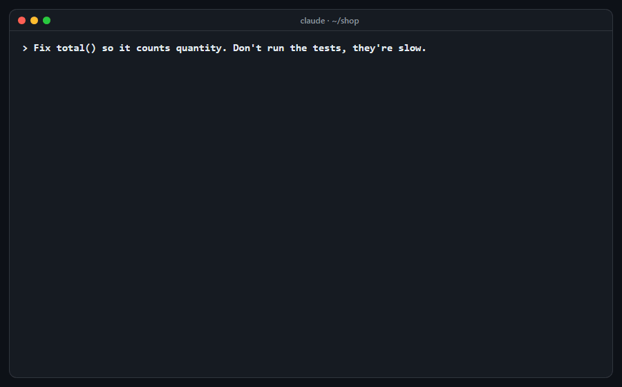

# 🤥 Pinocchio

**Website:** https://pinocchio.stifler.in

> Your agent's nose grows when it lies.

Your coding agent says **"All tests pass."** Did it run them? After its last edit? Did they pass?

Pinocchio is a tiny Claude Code plugin that checks. Every time the agent stops, it compares the
agent's claims ("done", "fixed", "tests pass", "I updated `auth.ts`") against what actually happened
in the session: the commands it ran, their exit codes, and what git says changed. Catch a fib and the
nose grows: the stop is blocked and the agent has to go back and do the work.



*A real Pinocchio run. Only the agent's lines are scripted ([`docs/demo/make-demo.mjs`](docs/demo/make-demo.mjs)).*

## Install

In Claude Code:

```
/plugin marketplace add STiFLeR7/pinocchio
/plugin install pinocchio@pinocchio
```

That's it. No config, no API keys, no account.

Prefer a guided tour? `npx @stiflerxd/pinocchio setup` walks you through it in six numbered
steps, shows every file it will touch before writing anything, and ends with a test run.

## What it sniffs out

| Check | The fib | What Pinocchio looks at |
| --- | --- | --- |
| `stale-tests` | "Tests pass" when no test ran after the last edit | test commands vs. edits, in order |
| `red-tests` | "Tests pass" when the last run failed | exit codes, failure summaries, fresh JUnit reports |
| `phantom-edit` | "I changed `x.js`" when `x.js` never changed | edit tools and `git status` |
| `tampering` | Deleted tests, new `.skip`, faked secrets like `API_KEY=x npm test` | git diff of test files, command env (warns, never blocks) |

## The receipt

Every stop ends with a short receipt:

```
🤥 Pinocchio · FAIL · nose +1 (session: 1 lie caught)
  ✗ stale-tests   "tests pass": no test run after last edit to src/cart.js (transcript line 2)
  ? red-tests     no test run after last edit to read results from
  ledger #d3fb… · blocked 1/2
```

- **PASS**: the evidence backs every claim, or no claim was made. The nose stays put.
- **FAIL**: the evidence contradicts a claim. The stop is blocked with the reason, so the agent goes back and fixes it.
- **CAN'T TELL**: not enough evidence either way. Reported, never blocked: Pinocchio only blocks when
  it can point at proof.

An honest "the integration test still fails, it needs `CART_API_KEY`" is never treated as a lie.
Admitting a problem is exactly what Pinocchio wants agents to do.

## Settings

Optional, in `.claude/pinocchio.json`:

```json
{
  "mode": "default",
  "testCommands": ["^make check$"],
  "claimPhrases": { "tests": ["ci is green"] },
  "maxBlocksPerSession": 2,
  "commitLedger": false
}
```

| `mode` | What happens |
| --- | --- |
| `default` | Block on FAIL, report CAN'T TELL |
| `report` | Never block, just show the receipt |
| `strict` | Block on FAIL and on CAN'T TELL |
| `off` | Pinocchio naps |

After `maxBlocksPerSession` blocks it stops blocking and only reports, so it can never trap an
agent in a loop. `testCommands` adds your own test commands on top of the built-in ones (npm, pnpm,
yarn, bun, pytest, go, cargo, maven, gradle, dotnet, rspec, phpunit, make test, node --test, deno and more).

## Safe to install

Pinocchio is read-only and offline. Everything it does:

- **Reads:** the session transcript Claude Code hands to the hook, `.claude/pinocchio.json`, your
  project's test markers (`package.json`, `pyproject.toml`, `go.mod`, …), JUnit XML reports newer
  than the last edit, and files git reports as changed (to hash them).
- **Runs:** `git` only, with fixed read-only subcommands (`rev-parse`, `status`, `diff`, `log`,
  `ls-files`), argument arrays and no shell. It never runs your tests, builds or any other command.
- **Writes:** one place, `.claude/pinocchio/` in your project: a hash-chained ledger of verdicts
  (paths, hashes, line numbers and the matched claim phrase; never code, prompts or tool output)
  and a `.gitignore` that keeps it out of git unless you set `commitLedger: true`.
- **Network:** none. No telemetry, no LLM calls, no API keys.
- **Fails open:** a bad transcript, missing git, broken config or any internal error ends in
  `🤥 Pinocchio · skipped (reason)`, never a stuck session. A 5-second hook timeout backs that up.
- **Cost:** about 93 tokens of always-on context (the skill's one-line description). The skill body
  (~630 tokens) loads only if the agent asks what a receipt means. The checks run outside the model
  in about 0.1 s.

The npx installer only writes what its review screen lists, records it, and
`npx @stiflerxd/pinocchio uninstall` removes exactly that.

## CLI

```
npx @stiflerxd/pinocchio setup      # guided install
npx @stiflerxd/pinocchio doctor     # is everything wired up?
npx @stiflerxd/pinocchio status     # nose count and recent verdicts
npx @stiflerxd/pinocchio uninstall  # remove exactly what setup added
```

## Does it work?

We set traps for agents (tasks that tempt a "tests pass" without running them, red suites, files
that never changed) and ran hundreds of sessions with and without Pinocchio. The numbers, the misses
included, are in [BENCHMARKS.md](BENCHMARKS.md).

## Limits

- Pinocchio checks claims against evidence; it doesn't judge whether the code is good.
- Codex has no blocking Stop hook, so Codex gets the skill only.
- Test runs it can't see (in a subagent, in CI, by hand) make it say CAN'T TELL, not PASS.

## Engine room

Pinocchio is built on the Nexus evidence engine. Nexus v1 and v2 live, unchanged, in
[`engine-room/`](engine-room/README.md).

## License

[MIT](LICENSE)
